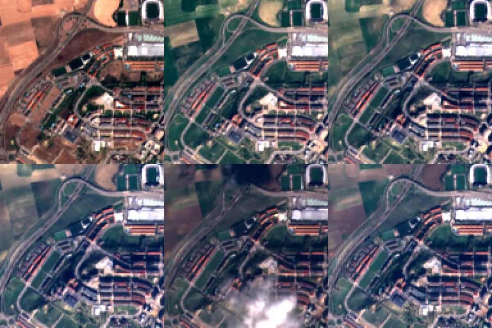
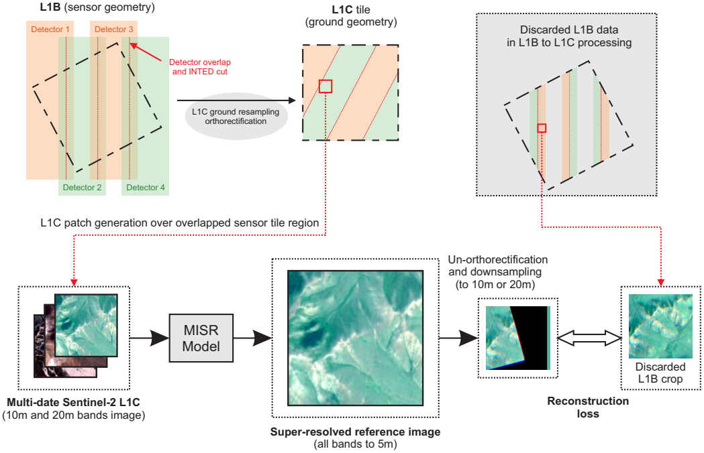

# Multi-Date Sentinel-2 Super-Resolution

Implementation of 'Self-Supervised Multi-Date Multi-Spectral Super-Resolution for Sentinel-2 Imagery'



## Graphical Abstract

Here is a graphical abstract of the proposed method from the paper:



## Usage

### Requirements
- Python 3.11
- GPU Nvidia 
- Install pytorch and dependencies:

```bash
conda install pytorch torchvision torchaudio pytorch-cuda=12.1 -c pytorch -c nvidia
pip install -r requirements.txt
```

### Pre-trained Models

Available models in `_trained_models/`:

| Model                            | Description                                             |
|----------------------------------|---------------------------------------------------------|
| `mdselfsen2.safetensors`         | Full model (10m + 20m): In paper **MD-SelfS2**          |
| `mdselfsen2_only10m.safetensors` | 10m bands only                                          |
| `sdselfsen2.safetensors`         | Single-date version (10m + 20m): In paper **SD-SelfS2** |
| `sdselfsen2_only10m.safetensors` | Single-date 10m only                                    |

### Inference on Examples

We provide a run single- and multi date super-resolution on example ROIs `_examples/` this will generate outputs in `_workspace/run_examples/`:

```bash
python run_examples.py
```

### Training

- Download dateset from [Hugging Face repository](https://huggingface.co/datasets/andersoncotrim/md_l1c_l1b_data) and place in `_data/` folder:
```
_data/
└── md_l1c_l1b_data/    (training data)
    ├── info/           (metadata for training/test sets, product info, date acquisition, orbits etc)
    ├── train.h5        (training data stored in HDF5 format)
    └── test.h5         (test data stored in HDF5 format)
└── ...
```

And run the script to train a new model:

```bash
python run_training.py [CONFIG]
```

where `[CONFIG]` is the name of the configuration (paper parameters) functions defined in `run_training.py` (e.g., `mdselfsen2`, `sdselfsen2`, `mdselfsen2_only10m`, `sdselfsen2_only10m`):

You can training by editing `run_training.py` with desired parameters:
- Number of epochs
- Learning rate
- Batch size
- Input/output bands
- Number of auxiliary frames

### OpenSR Test

- Download dateset from [Hugging Face repository](https://huggingface.co/datasets/andersoncotrim/md_l1c_l1b_data) and place in `_data/` folder:

```
_data/
├── ...
├── opensr_original/    (original OpenSR test data, single date)
└── opensr_md_v2/       (auxiliary frames for multi-date OpenSR data)
```

1) Predict and export results as georeferenced GeoTIFF:

```bash
python run_opensr_gen_geotiff.py
```

2) Calculate quality metrics (OpenSR Metrics, PSNR, SSIM, etc.):

```bash
python run_opensr_compute_metrics.py
```

## Citation


If you use this repository in your research, please cite our paper:

```
@article{cotrim2026selfsupervised,
  title   = {Self-Supervised Multi-Date Multi-Spectral Super-Resolution for Sentinel-2 Imagery},
  author  = {Cotrim, A. Nogueira and Anger, J. and Facciolo, G. and Santos, C. A. Nogueira and Pedrini, H.},
  journal = {IEEE Transactions on Geoscience and Remote Sensing},
  year    = {2026},
  note    = {Accepted for publication}
}
```

## License

This repository's source code is licensed under the MIT License. See the [LICENSE](LICENSE) file for details.
The associated datasets are provided separately and are subject to their own licenses and usage restrictions. Please consult the official dataset pages for access conditions and licensing information.

## Acknowledgments

- https://github.com/ESAOpenSR/opensr-test

